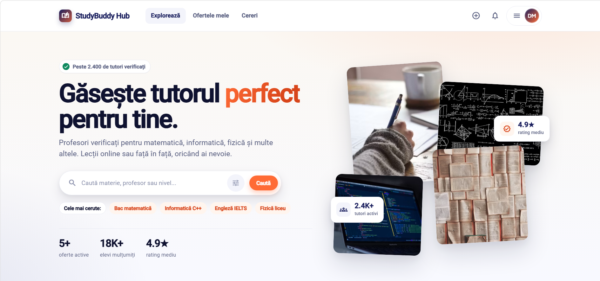
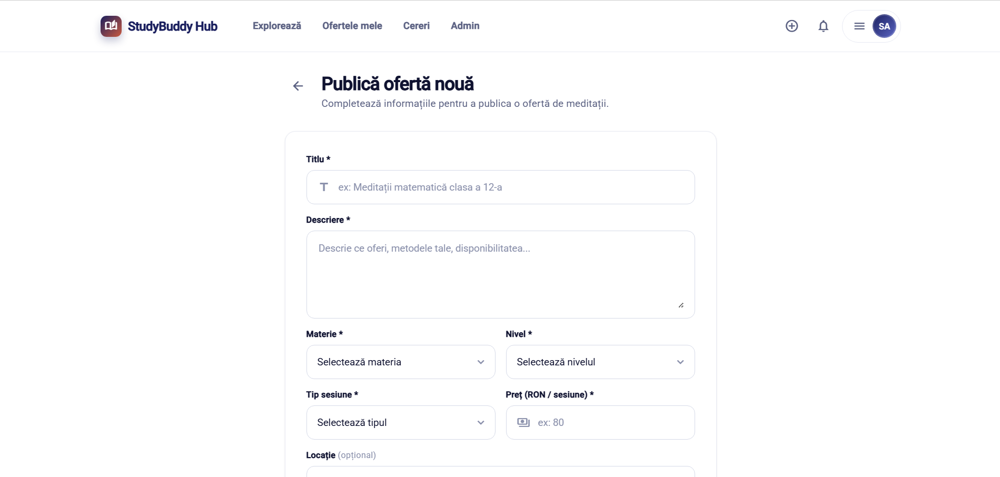
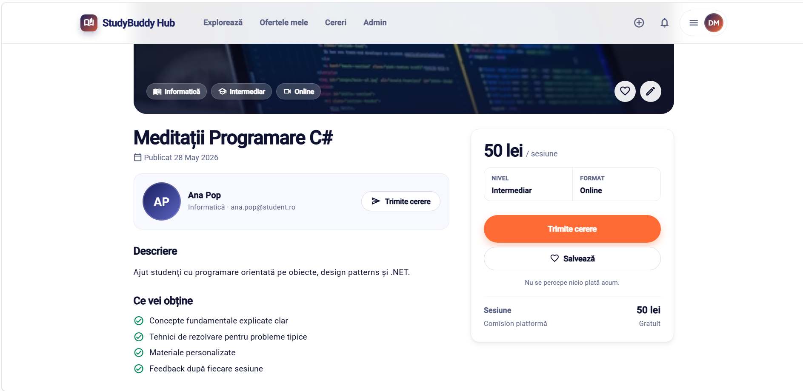

# StudyBuddyHub

Aplicație web full-stack pentru studenți — platformă de anunțuri pentru meditații și sesiuni de studiu colaborativ, cu plăți Stripe și notificări în timp real.

## Capturi de ecran

### Pagina principală


### Publicare ofertă


### Detalii ofertă


## Stack tehnic

- **Backend**: ASP.NET Core 10 Web API, EF Core (Npgsql), ASP.NET Core Identity, JWT, SignalR
- **Frontend**: Angular 19, Angular Material (tema Indigo/Pink), standalone components, lazy loading
- **Baza de date**: PostgreSQL 17
- **Plăți**: Stripe Checkout + Webhooks
- **E2E**: Playwright
- **Containerizare**: Docker + Docker Compose (Nginx pentru frontend)

## Arhitectură backend

```
StudyBuddyHub.Api            ← Controllers, DTOs, Hubs, Middleware, Mappings
StudyBuddyHub.Core           ← Entities, Interfaces, Enums
StudyBuddyHub.Infrastructure ← DbContext, Repositories, Services, Migrations
StudyBuddyHub.Tests          ← xUnit Tests
e2e                          ← Playwright end-to-end tests
```

## Entități

| Entitate        | Relații |
|-----------------|---------|
| ApplicationUser | 1-N StudyOffer, 1-N StudyRequest, N-N StudyOffer (prin FavoriteOffer) |
| StudyOffer      | N-1 User, N-1 Subject, 1-N StudyRequest |
| StudyRequest    | N-1 StudyOffer, N-1 User |
| Subject         | 1-N StudyOffer |
| FavoriteOffer   | N-1 User, N-1 StudyOffer |
| Role            | Identity |

## Controllere API

| Controller | Route | Protejat |
|---|---|---|
| AuthController | `/api/auth` | parțial |
| StudyOffersController | `/api/studyoffers` | parțial |
| StudyRequestsController | `/api/studyrequests` | complet |
| SubjectsController | `/api/subjects` | nu |
| FavoritesController | `/api/favorites` | complet |
| PaymentsController | `/api/payments` | parțial (webhook public) |
| AdminController | `/api/admin` | Admin only |

## SignalR Hubs

| Hub | Endpoint | Autentificare |
|---|---|---|
| NotificationHub | `/hubs/notifications` | JWT (via `access_token` query) |

Notificările sunt emise prin `SignalRNotificationService` la evenimente precum primirea sau acceptarea unei cereri.

## Pagini frontend

| Pagină | Rută | Guard |
|---|---|---|
| Home / Oferte | `/` | — |
| Login | `/login` | — |
| Register | `/register` | — |
| Detalii ofertă | `/offers/:id` | — |
| Creare ofertă | `/offers/create` | Auth |
| Editare ofertă | `/offers/:id/edit` | Auth |
| Profil | `/profile` | Auth |
| Ofertele mele | `/dashboard/my-offers` | Auth |
| Cererile mele | `/dashboard/my-requests` | Auth |
| Plată reușită | `/payment/success` | — |
| Plată anulată | `/payment/cancel` | — |
| Admin panel | `/admin` | Admin |

## Pași de rulare

### Prerequisite

- [.NET 10 SDK](https://dotnet.microsoft.com/download)
- [Node.js 20+](https://nodejs.org/) și npm
- [PostgreSQL 17](https://www.postgresql.org/download/) (sau Docker)
- [Docker Desktop](https://www.docker.com/products/docker-desktop/) (opțional, pentru rulare containerizată)

### Variabile de mediu

Creează un fișier `.env` în rădăcina proiectului (folosit de `docker-compose`):

```env
POSTGRES_DB=studybuddyhub
POSTGRES_USER=postgres
POSTGRES_PASSWORD=postgres
JWT_KEY=superSecretKey@345superSecretKey@345
JWT_ISSUER=StudyBuddyHub
JWT_AUDIENCE=StudyBuddyHub
FRONTEND_URL=http://localhost:4200
STRIPE_SECRET_KEY=sk_test_...
STRIPE_WEBHOOK_SECRET=whsec_...
```

### Opțiunea 1 — Docker Compose (recomandat)

```bash
docker network create studlab_net   # o singură dată
docker compose -f docker-compose.yml -f docker-compose.local.yml up --build
# API:      http://localhost:8080
# Frontend: http://localhost:4200
```

### Opțiunea 2 — Rulare manuală

**Backend:**

```bash
cd StudyBuddyHub.Api
dotnet run
# API disponibil la http://localhost:8080
# Swagger UI la http://localhost:8080/swagger
```

Baza de date și seed-ul se aplică automat la prima rulare. Datele seed includ:
- Admin: `admin@studybuddy.com` / `Admin123!`
- 8 materii predefinite

**Frontend:**

```bash
cd study-buddy-hub-frontend
npm install
npm start
# Frontend la http://localhost:4200
```

**Teste E2E (Playwright):**

```bash
cd e2e
npm install
npx playwright install
npm test            # headless
npm run test:headed # cu browser vizibil
npm run test:ui     # UI mode
```

## Credențiale implicite

| Email | Parolă | Rol |
|---|---|---|
| admin@studybuddy.com | Admin123! | Admin |

## Funcționalități implementate

- Autentificare JWT cu roluri (Admin, Student)
- CRUD complet StudyOffer cu filtrare
- Trimitere/acceptare/respingere cereri de participare
- Favorite (relație N-N User ↔ StudyOffer)
- Plăți Stripe Checkout + webhook pentru confirmare
- Notificări în timp real prin SignalR (Observer pattern)
- Panou admin (statistici, gestiune utilizatori)
- Middleware global de excepții (JSON 400/403/404/500)
- Logging cu `ILogger<T>`
- Protected routes cu Angular Guards
- HTTP Interceptor pentru JWT
- Formulare cu validare client-side
- Suite Playwright pentru fluxurile principale (auth, offers, dashboard, payment, admin)
